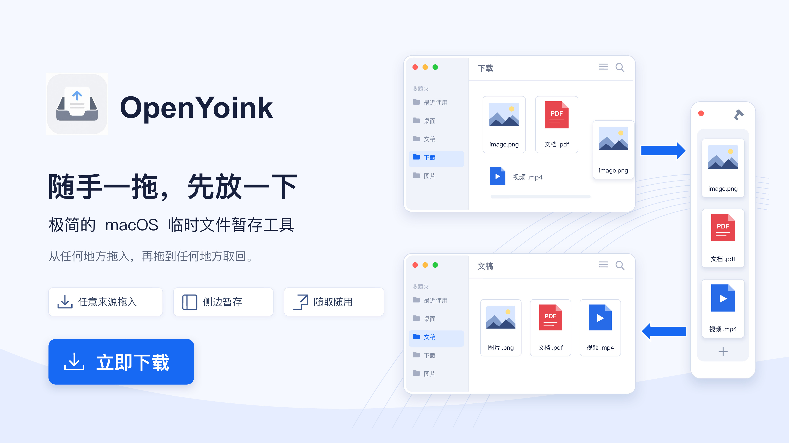
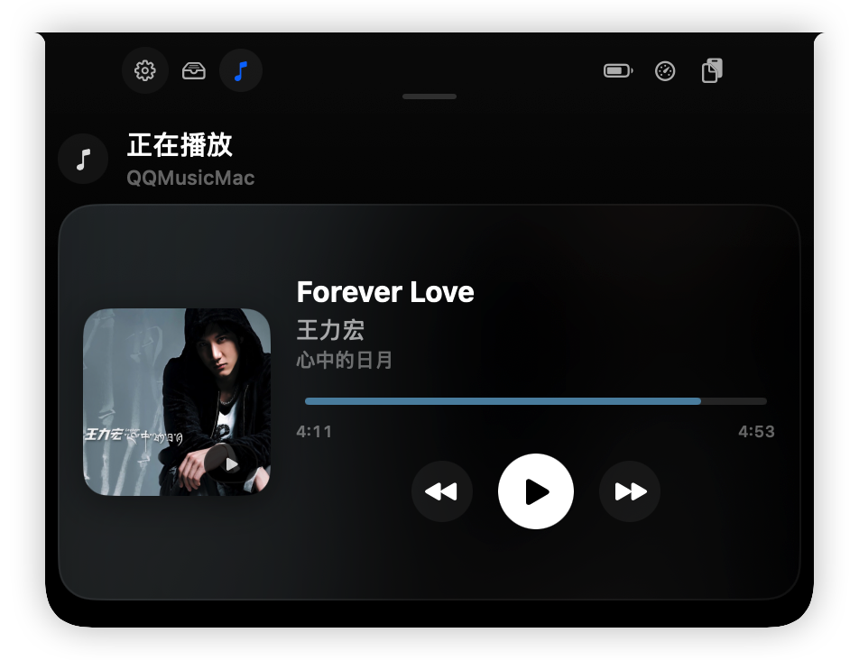
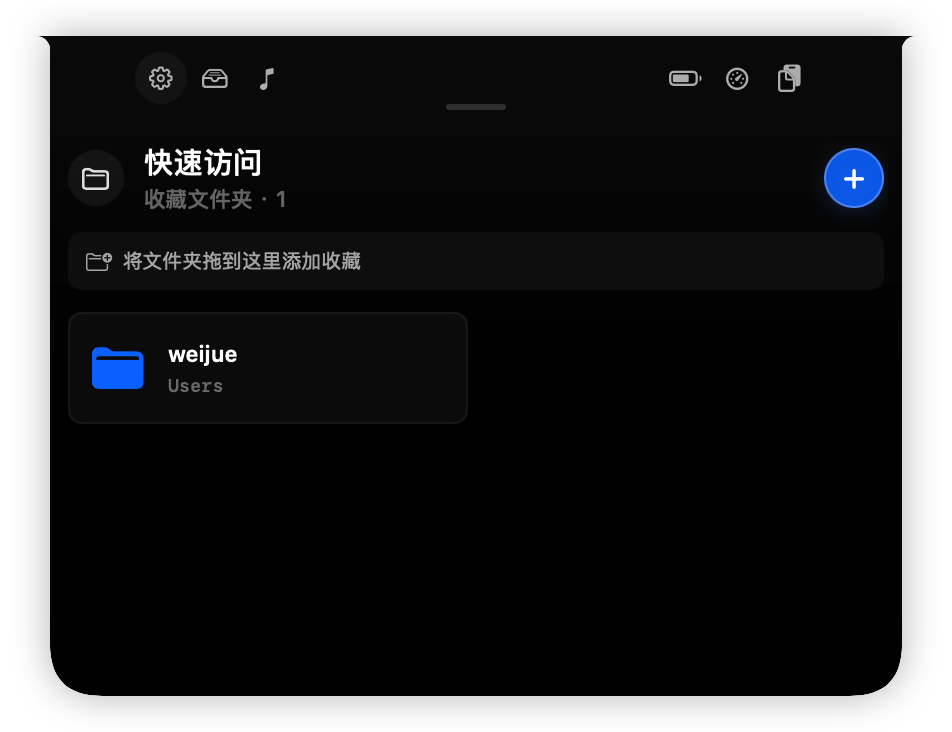
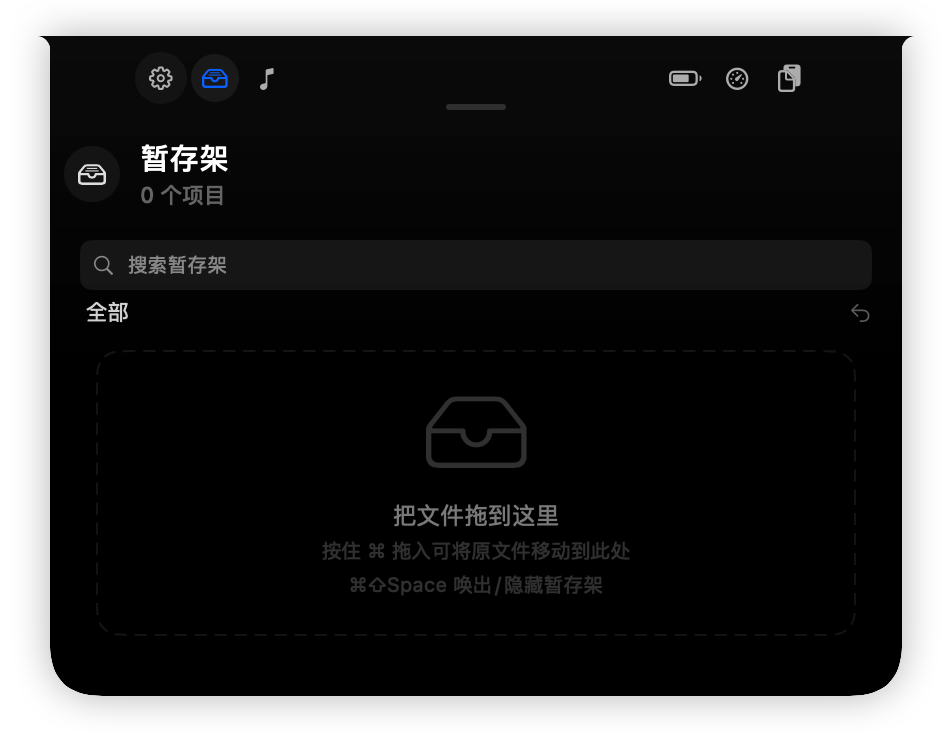
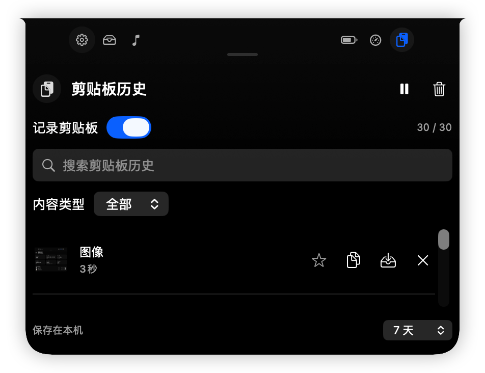
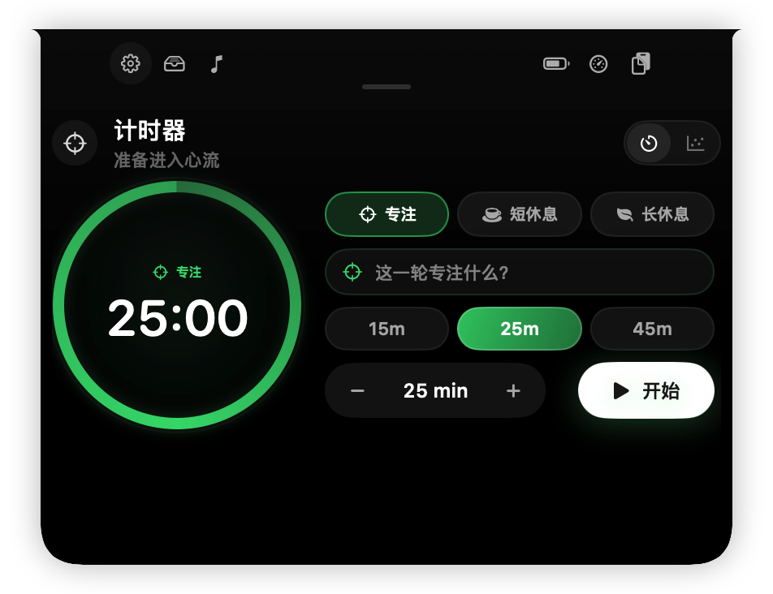
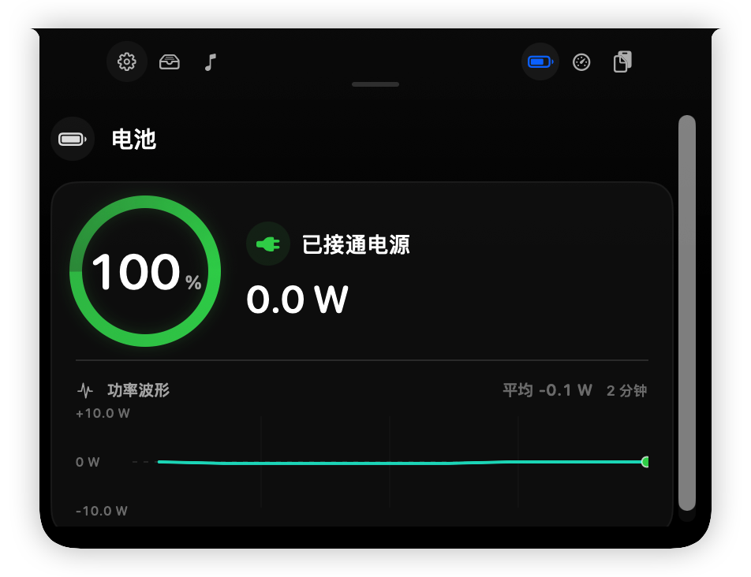
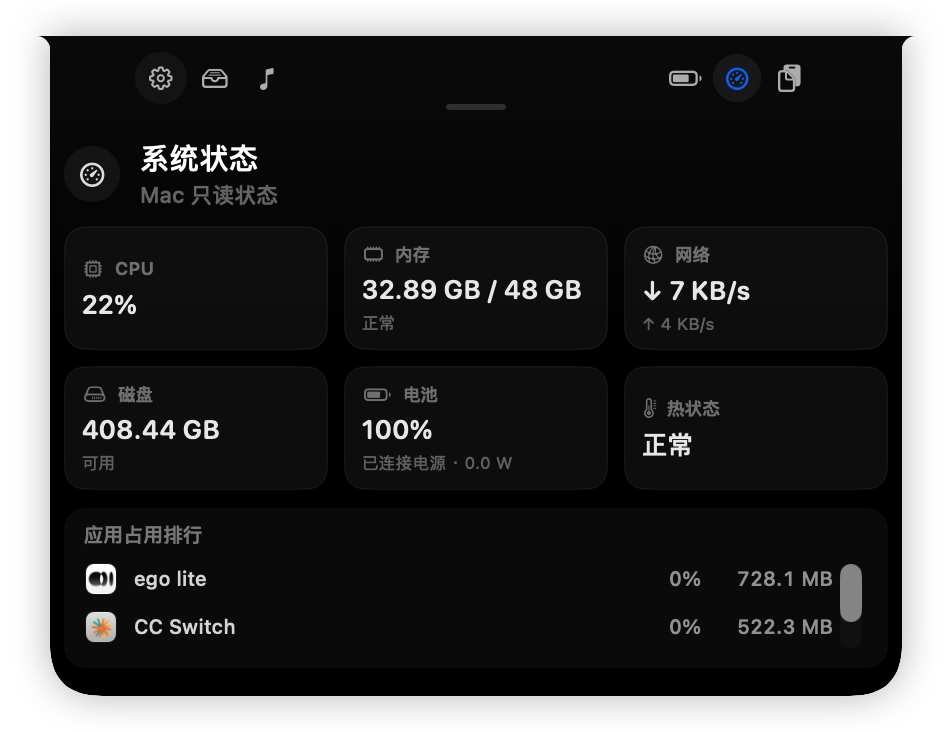
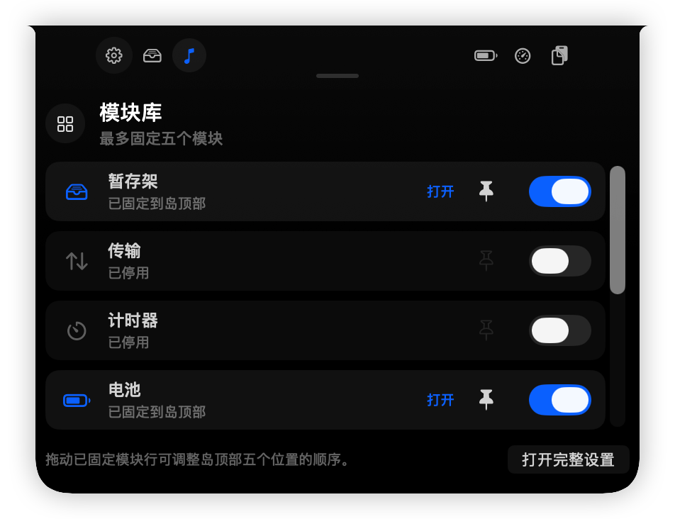

<div align="center">



# OpenYoink

**Drag it. Park it. Drop it later.**

A free, open-source shelf and Dynamic Island for macOS. Keep files within reach,
control music, run a focus timer, check system status, and find clipboard history at the top of your screen.

<br>

[](https://github.com/MuQY1818/OpenYoink/releases/latest)
[](https://github.com/MuQY1818/OpenYoink/releases)
[](https://developer.apple.com/macos/)
[](https://github.com/MuQY1818/OpenYoink/stargazers)
[](LICENSE)

[Download](https://github.com/MuQY1818/OpenYoink/releases/latest) ·
[Website](https://muqy1818.github.io/OpenYoink/) ·
[Island](#island-modules) ·
[Product film](https://muqy1818.github.io/OpenYoink/en/#film) ·
[Guide](https://muqy1818.github.io/OpenYoink/en/guide/) ·
[中文](README.md)

</div>

<br>

<a href="https://muqy1818.github.io/OpenYoink/">
  
</a>

To send a file from Downloads to a chat, drop it in OpenYoink first. Let go of the mouse, switch to the chat window, then drag it out.

OpenYoink lives in the menu bar without a Dock icon. Use the side shelf, the notch interface, or both. They share the same contents.

## Features

- Store files, folders, text, images, and links. Mail messages, calendar events, and contacts are supported when the source app provides them.
- Preview with Space, select multiple items, group them into stacks, reorder them, or return to recent items.
- Open the shelf with an edge tab, a shortcut, a mouse-shake gesture, or a drag. Automatic triggers can be disabled per app.
- Optional clipboard history with favorites, type filters, search, preview, copy, and add-to-shelf actions. Recording is off by default.
- Multiple displays, Spaces, and full-screen apps; English and Chinese UI; launch at login and automatic updates.

## Island modules

OpenYoink Island puts everyday tools at the top of your Mac. The compact view shows playback status, a countdown, or an activity summary; click to open the module. On a notched Mac, it joins the camera housing. External and non-notched displays use a floating top capsule.

### Module previews

Check artwork, track details, and progress without switching to the player. Pause, skip tracks, or seek when the player supports it. The screenshot shows QQ Music. Available information and controls for other players and browser videos depend on their media interfaces.

These are actual app screenshots with the Chinese UI. Click an image to view it at full size.

<table>
  <tr>
    <td width="50%" valign="top">
      <a href="docs/screenshots/island/now-playing.png"></a>
      <p><strong>Now Playing</strong><br>Track details, artwork, pause and skip controls, with seeking when the player supports it.</p>
    </td>
    <td width="50%" valign="top">
      <a href="docs/screenshots/island/quick-access.png"></a>
      <p><strong>Quick Access</strong><br>Favorite folders; double-click to open in the macOS default file manager, including Finder or QSpace. Drop files onto a folder to copy them with a name-conflict prompt.</p>
    </td>
  </tr>
  <tr>
    <td width="50%" valign="top">
      <a href="docs/screenshots/island/shelf.png"></a>
      <p><strong>Shelf</strong><br>Shares contents with the side shelf, with drag-and-drop, search, type filters and Quick Look.</p>
    </td>
    <td width="50%" valign="top">
      <a href="docs/screenshots/island/clipboard-history.png"></a>
      <p><strong>Clipboard History</strong><br>Find copied text, links and images, favorite useful entries, copy them or add them to the shelf. Recording is a separate opt-in.</p>
    </td>
  </tr>
  <tr>
    <td width="50%" valign="top">
      <a href="docs/screenshots/island/timer.png"></a>
      <p><strong>Focus timer</strong><br>Choose focus, a short break or a long break, and add a session goal. Customize the duration, pause, resume and review focus history.</p>
    </td>
    <td width="50%" valign="top">
      <a href="docs/screenshots/island/battery.png"></a>
      <p><strong>Battery and power</strong><br>Check charge, power source and charging or discharging watts. The live graph shows the last two minutes and average power.</p>
    </td>
  </tr>
  <tr>
    <td width="50%" valign="top">
      <a href="docs/screenshots/island/system-status.png"></a>
      <p><strong>System Status</strong><br>CPU, memory, network rates, available disk space, battery, thermal state and app usage. Read-only; it does not end processes or clean files.</p>
    </td>
    <td width="50%" valign="top">
      <a href="docs/screenshots/island/module-library.png"></a>
      <p><strong>Module library</strong><br>Enable what you use, pin up to five modules and drag pinned rows to reorder them. Unpinned modules remain available in the library.</p>
    </td>
  </tr>
</table>

Battery power measures charging or discharging at the battery, not wall-outlet consumption. Positive means charging; negative means discharging. A reading near `0 W` is normal when plugged in with a full battery.

The Transfers module also shows asynchronous file delivery progress and failures.

### Set up your modules

1. Enable OpenYoink Island in **Settings → General**. It is enabled for new installs.
2. Expand Island and click the upper-left gear to open the module library. Enable a module, then pin it to keep it in the top strip.
3. Drag pinned rows to reorder them. Press `Esc`, click outside, or click the top-center area to collapse Island.

Now Playing, Quick Access and Clipboard History modules are off by default. Enabling the clipboard module does not start recording. Island and the side shelf can be enabled independently.

Top-edge drag-to-expand is off by default. Enable it separately in **Settings → Triggers**; side-shelf triggers are independent.

[Island guide](https://muqy1818.github.io/OpenYoink/en/guide/island) · [Watch the 40-second film](https://muqy1818.github.io/OpenYoink/en/#film)

## Install

Requires macOS 15 Sequoia or later. Supports Apple Silicon and Intel Macs.

### Homebrew (recommended)

```bash
brew install --cask muqy1818/tap/openyoink
```

Homebrew downloads the package from GitHub Releases and removes OpenYoink's quarantine attribute after installation. This bypasses quarantine checks for this app; it does not mean the build is notarized by Apple.

### Manual installation

1. Download the latest DMG from [GitHub Releases](https://github.com/MuQY1818/OpenYoink/releases/latest).
2. Open the DMG and drag OpenYoink into `Applications`.
3. If macOS blocks the first launch, right-click OpenYoink in Finder and choose **Open**, or allow it under **System Settings → Privacy & Security**.

> [!NOTE]
> Community builds on GitHub Releases are ad-hoc signed and not notarized by Apple. macOS may block a manual installation. Automatic updates use Sparkle EdDSA verification, which does not replace verification of the first download or Apple notarization.

<details>
<summary>Still unable to open the app?</summary>

First confirm that the package came from GitHub Releases above. Run `shasum -a 256 OpenYoink-VERSION.dmg` (replace `VERSION` with the release number), then compare it with the checksum in the matching release notes or [Homebrew cask](https://github.com/MuQY1818/homebrew-tap/blob/main/Casks/openyoink.rb).

After checking the source and checksum, you can remove OpenYoink's quarantine attribute with the command below. This bypasses Gatekeeper's quarantine check for this app:

```bash
xattr -dr com.apple.quarantine /Applications/OpenYoink.app
```

</details>

## Quick start

| Action               | How                                                        |
| -------------------- | ---------------------------------------------------------- |
| Show / hide          | `⌘⇧Space`, the menu bar item, or click the screen edge tab |
| Add content          | Drop onto the shelf or the edge tab                        |
| Managed move         | Hold `⌘` while importing; the original goes to the Trash after a copy is confirmed. [Details](#file-safety-and-lifecycle) |
| Park clipboard       | Press `⌘⇧Space` twice                                      |
| Clipboard history    | `⌘⇧V`, configurable in Settings                           |
| Search / undo remove | `⌘F` / `⌘Z` (manual card removal only)                    |
| Quick Look           | Select a card and press `Space`, or double-click           |
| Multi-select         | Hold `⌘` and click, or marquee-select an empty area       |
| Remove               | Hover and click `×`, press `Delete`, or use the context menu |
| Reposition           | Drag the edge tab, or pick a position in Settings          |
| Enable / disable Island | Settings → General → OpenYoink Island                    |

Drag-to-expand at the top of the screen is off by default and can be enabled in Settings. Side-shelf drag triggers are configured separately. See the [guide](https://muqy1818.github.io/OpenYoink/en/guide/) for more.

## File safety and lifecycle

Regular imports reference the original file without moving it. Removing a card or choosing "remove after drop" does not delete the original. Drops onto Finder request a copy; the destination decides whether to accept it.

> [!WARNING]
> Holding `⌘` while importing uses managed move: OpenYoink copies the content into its sandbox, confirms the copy, then moves the original to the Trash. If a step fails, it keeps the original and falls back to a regular reference. The original is recoverable only until the Trash is emptied.

For managed moves, the shelf card and sandbox copy are deleted only after the destination confirms delivery, regardless of the regular "after drop" policy. Failed or cancelled drops keep both for retry.

<details>
<summary>How each content type is stored and cleaned up</summary>

| Content                          | How OpenYoink handles it                                  |
| -------------------------------- | --------------------------------------------------------- |
| Files and folders                | Keeps a sandbox bookmark to the original location         |
| Plain text and links             | Stored directly in the shelf data                         |
| Images, HTML, RTF                | Saved as files in the app sandbox                         |
| Contacts, events, mail messages  | Saved as `.vcf`, `.ics`, `.eml` when the source provides them |

If the original file is moved, deleted, or on an offline disk, its card is unavailable until the reference resolves again.

Text and links are stored with their cards and cleared when the cards are removed. Files created for images, rich text, and mail are normally cleaned up on the next launch after their cards are removed. You can also review and clear unused files in **Settings → Storage**.

Regular file drops provide a file URL and a Chromium-compatible filename. Managed moves use a file promise and wait for confirmation of the destination write. Compatibility depends on the receiving app or website.

</details>

## Privacy and permissions

- No account, analytics, or telemetry. Content stays in the local sandbox under `Application Support/OpenYoink`.
- App Sandbox is enabled. File access comes from content you drag in or choose. Normal use does not require Accessibility or Input Monitoring permissions.
- Automatic update checks are on by default and can be disabled. The app's background network requests go to GitHub Pages / Releases to check for and download updates.
- Now Playing does not use the network. It prefers a local helper; its Apple Music / Spotify AppleScript fallback may request Automation permission. A module failure does not affect the shelf.
- Quick Access stores references only to folders you add. Removing a favorite does not delete the folder, and macOS chooses the default app for opening it.

### Clipboard history

Recording is off by default. While it is disabled, OpenYoink reads the clipboard only when you double-press the shortcut to save it. Enabling or resuming recording captures only newly copied text, HTTP(S) URLs, and PNG/TIFF images, not existing clipboard content or copied files.

History is stored as plaintext on this Mac, without uploads or sync. Choose 30, 100, or 300 ordinary entries (30 by default), with 1, 7, or 30 days of retention (7 by default). Up to 30 additional favorites do not expire. All contents share a 20 MiB budget. Turning recording off keeps existing history; clearing it deletes the saved entries.

General settings offer File Shelf, Files & Clipboard, and Full Toolbox presets. They change modules and reveal behavior without enabling clipboard recording or deleting data. Side shelf and Island reveal controls are together in Triggers.

Common password-manager privacy markers and ignored apps are skipped, but not all sensitive content can be detected. Pause recording before copying passwords or tokens.

## Build from source

You need macOS 15+ and Xcode 26+.

```bash
git clone https://github.com/MuQY1818/OpenYoink.git
cd OpenYoink

xcodebuild \
  -project Open-Yoink.xcodeproj \
  -scheme OpenYoink \
  -destination 'platform=macOS' \
  build

xcodebuild \
  -project Open-Yoink.xcodeproj \
  -scheme OpenYoink \
  -destination 'platform=macOS' \
  test \
  -only-testing:OpenYoinkTests
```

Built with Swift 6, SwiftUI, and AppKit. Local builds do not require a `DEVELOPMENT_TEAM`. The test command above runs app unit tests, not UI automation.

[`Scripts/make-release.sh`](Scripts/make-release.sh) supports Developer ID signing and notarization, or an explicit `--adhoc` community build. Signing failures do not trigger an automatic fallback.

## Contributing

For bugs or feature suggestions, open an [issue](https://github.com/MuQY1818/OpenYoink/issues). Include your macOS version, OpenYoink version, and steps to reproduce. Please keep private files and clipboard content out of screenshots.

Pull requests are welcome too. Discuss larger changes in an issue first, and run the full unit test suite before submitting code.

## Star history

<a href="https://www.star-history.com/?repos=MuQY1818%2FOpenYoink&amp;type=date">
  <picture>
    <source media="(prefers-color-scheme: dark)" srcset="https://api.star-history.com/svg?repos=MuQY1818/OpenYoink&amp;type=Date&amp;theme=dark">
    <source media="(prefers-color-scheme: light)" srcset="https://api.star-history.com/svg?repos=MuQY1818/OpenYoink&amp;type=Date">
    
  </picture>
</a>

## Credits and license

OpenYoink is released under the [MIT License](LICENSE). It is an independent open-source project, not affiliated with the commercial Yoink app or its developers.

Updates use [Sparkle](https://sparkle-project.org/); the star chart is provided by [Star History](https://www.star-history.com/). Third-party components and licenses are listed in [`THIRD_PARTY_NOTICES.md`](THIRD_PARTY_NOTICES.md).

<br>

<div align="center">

© 2026 weijue · MIT License

</div>
