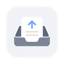
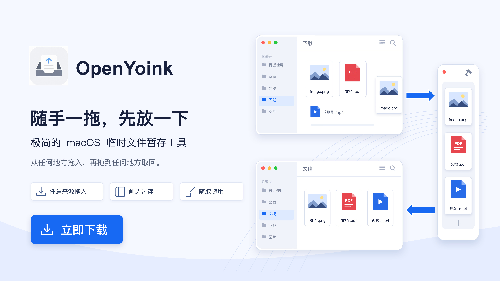
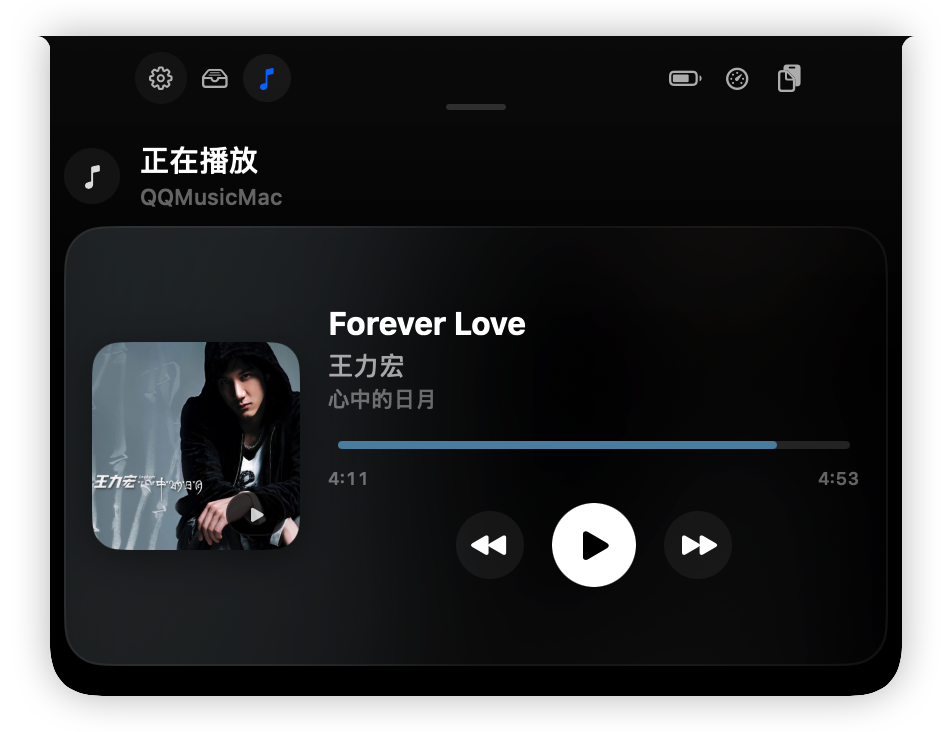
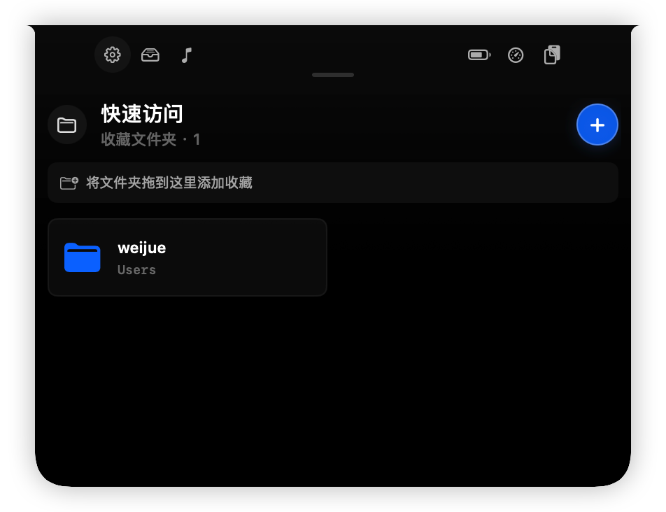
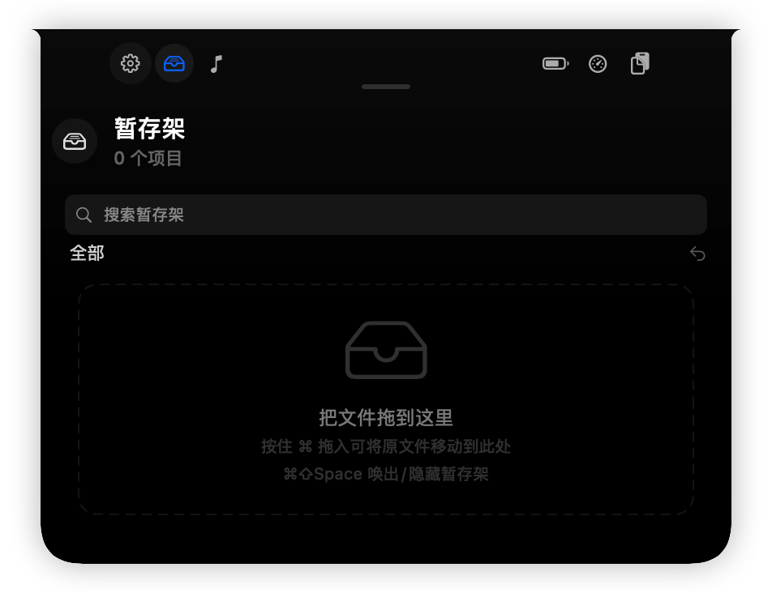
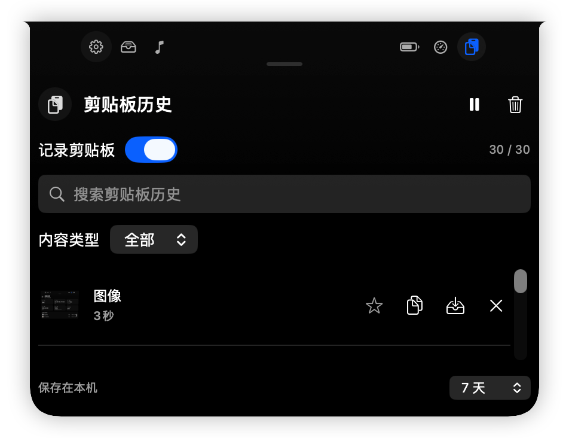
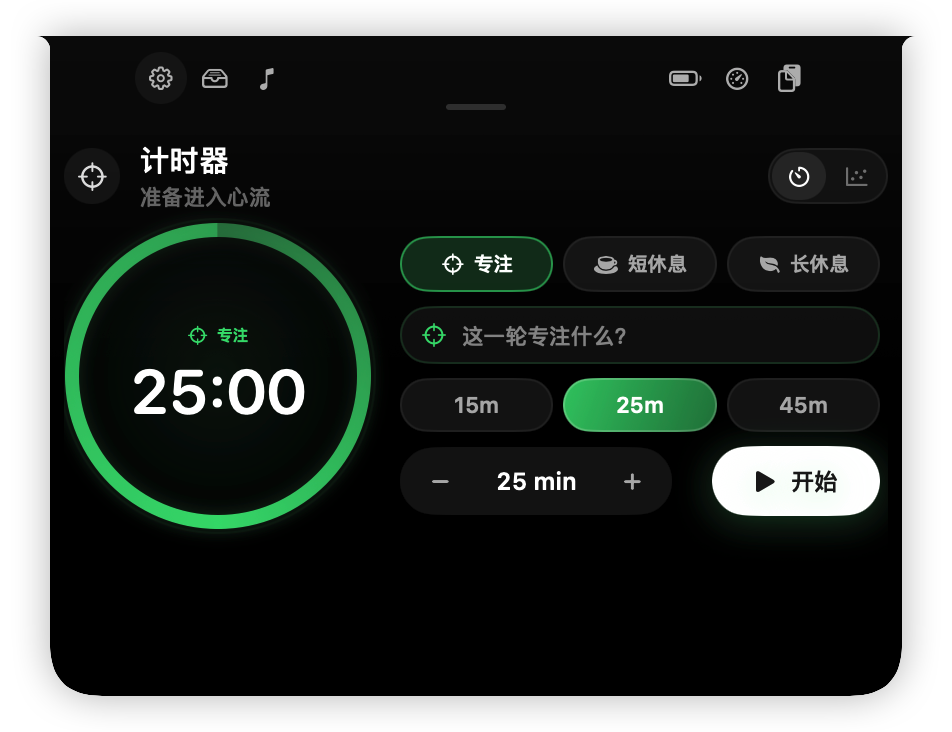
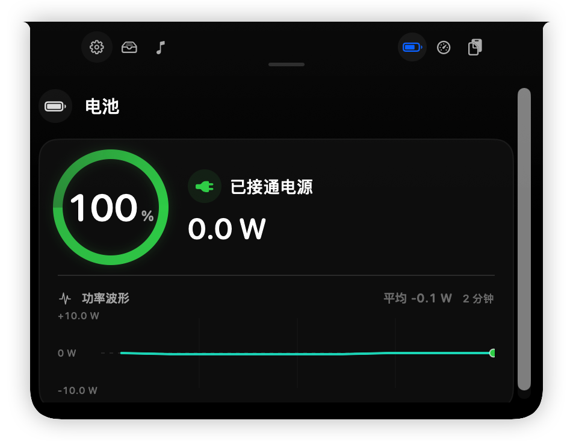
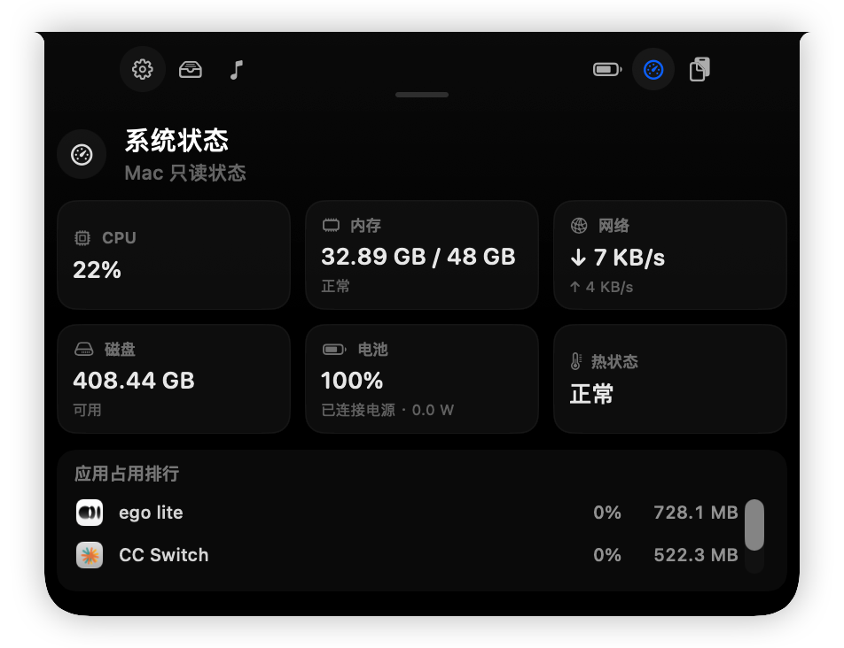
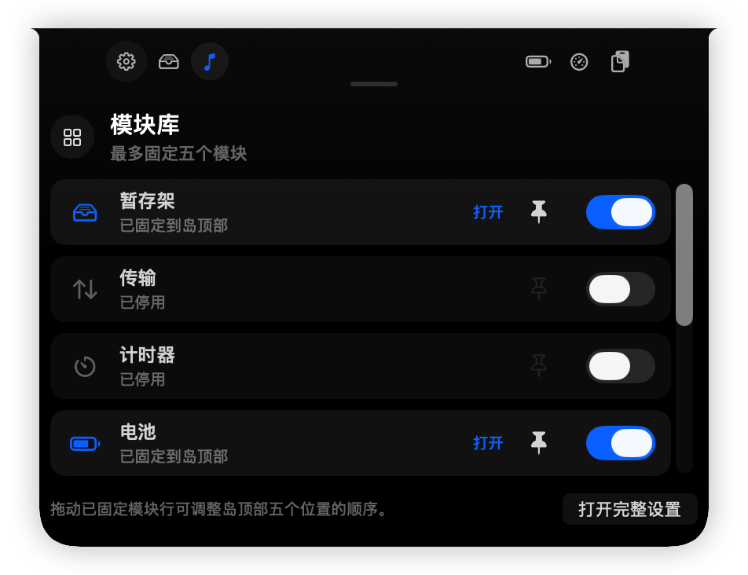

<div align="center">



# OpenYoink

**Drag it. Park it. Drop it later.**

A free, open-source shelf for macOS, with a Dynamic Island on top.
Park files at the edge of the screen; keep music, timers and your clipboard in the notch.

<br>

[](https://github.com/MuQY1818/OpenYoink/releases/latest)
[](https://github.com/MuQY1818/OpenYoink/releases)
[](https://developer.apple.com/macos/)
[](https://github.com/MuQY1818/OpenYoink/stargazers)
[](LICENSE)

[Download](https://github.com/MuQY1818/OpenYoink/releases/latest) ·
[Website](https://muqy1818.github.io/OpenYoink/) ·
[Island](#island-modules) ·
[Product film](https://muqy1818.github.io/OpenYoink/en/#film) ·
[Guide](https://muqy1818.github.io/OpenYoink/en/guide/) ·
[中文](README.md)

</div>

<br>

<a href="https://muqy1818.github.io/OpenYoink/">
  
</a>

Want to send a file from Downloads to a chat? Drag it to OpenYoink at the edge of the screen, let go, switch to the chat, and drag it back out. No more arranging two windows side by side.

OpenYoink lives in the menu bar and stays out of the Dock. Use the side shelf, the Island at the top, or both — they hold the same items.

## What it does

- **Holds almost anything**: files, folders, text, images and links. Mail messages, calendar events and contacts too, when the source app hands them over.
- **Keeps things findable**: preview with Space, multi-select or drag a selection box, group items into stacks, search, filter by type, and press `⌘Z` when you remove something by accident.
- **Shows up when you need it**: click the tab on the screen edge, press a shortcut, shake the mouse, or just drag a file toward it. Automatic reveal can be turned off for specific apps.
- **Clipboard history**: favorites, search, preview, and one-click add to the shelf. It is off until you turn it on.
- Works across displays, Spaces and full-screen apps. English and Chinese UI, launch at login, automatic updates.

## Island modules

OpenYoink Island sits at the top of the screen. Collapsed, it shows what's playing, a countdown, or transfer progress; click it to open a module. On a notched Mac it merges with the notch. On external and non-notched displays it floats as a small capsule.

These are real screenshots (Chinese UI). Click one to see it full size.

<table>
  <tr>
    <td width="50%" valign="top">
      <a href="docs/screenshots/island/now-playing.png"></a>
      <p><strong>Now Playing</strong><br>See the artwork, pause, or skip without switching to the player. Shown here with QQ Music; seeking and the details you get depend on what the player or web page exposes.</p>
    </td>
    <td width="50%" valign="top">
      <a href="docs/screenshots/island/quick-access.png"></a>
      <p><strong>Quick Access</strong><br>Pin the folders you use most and double-click to open them in your default file manager (Finder, QSpace, and so on). Drop a file onto a folder to copy it there; you'll be asked before anything is overwritten.</p>
    </td>
  </tr>
  <tr>
    <td width="50%" valign="top">
      <a href="docs/screenshots/island/shelf.png"></a>
      <p><strong>Shelf</strong><br>The same items as the side shelf, with the same drag in/out, search, filters and Quick Look.</p>
    </td>
    <td width="50%" valign="top">
      <a href="docs/screenshots/island/clipboard-history.png"></a>
      <p><strong>Clipboard History</strong><br>Dig up text, links and images you copied earlier, and keep the useful ones as favorites. Recording has its own switch and starts off.</p>
    </td>
  </tr>
  <tr>
    <td width="50%" valign="top">
      <a href="docs/screenshots/island/timer.png"></a>
      <p><strong>Focus Timer</strong><br>Focus, short break, or long break. Jot down what this round is for, pick your own durations, and keep a record of your sessions.</p>
    </td>
    <td width="50%" valign="top">
      <a href="docs/screenshots/island/battery.png"></a>
      <p><strong>Battery &amp; Power</strong><br>Charge level, whether you're charging, the current wattage, and a two-minute power graph with the average.</p>
    </td>
  </tr>
  <tr>
    <td width="50%" valign="top">
      <a href="docs/screenshots/island/system-status.png"></a>
      <p><strong>System Status</strong><br>CPU, memory, network speed, free disk space, thermal state, and which apps are using the most. Look only — it never kills processes or deletes files.</p>
    </td>
    <td width="50%" valign="top">
      <a href="docs/screenshots/island/module-library.png"></a>
      <p><strong>Module Library</strong><br>Turn on only what you use, pin up to five to the top, and drag to reorder. Unpinned modules can still be opened from the library.</p>
    </td>
  </tr>
</table>

> [!TIP]
> The battery module measures power at the battery, not at the wall. Positive means charging, negative means discharging. Seeing about `0 W` while plugged in with a full battery is normal.

There is also a Transfers module that shows the progress and failures of files being delivered in the background.

### Setting it up

Island is on by default for new installs (turn it off in **Settings → General**). Expand it, click the gear in the top-left corner to open the module library, turn on the modules you want, pin them, and drag to reorder. Press `Esc`, click outside, or click the top-center area to collapse it.

If you'd rather not pick modules one by one, **Settings → General** has three presets: File Shelf, Files & Clipboard, and Full Toolbox. They only change modules and reveal behavior; your files and history stay put, and clipboard recording stays however you left it.

Now Playing, Quick Access and Clipboard History start off. Expanding Island by dragging a file to the top of the screen is also off by default; turn it on in **Settings → Triggers**. It doesn't affect how the side shelf is revealed.

[Island guide](https://muqy1818.github.io/OpenYoink/en/guide/island) · [Watch the 40-second film](https://muqy1818.github.io/OpenYoink/en/#film)

## Install

Requires macOS 15 Sequoia or later, on Apple silicon or Intel.

### Homebrew (recommended)

```bash
brew install --cask muqy1818/tap/openyoink
```

The package comes from GitHub Releases as well. After installing, Homebrew removes OpenYoink's quarantine flag so Gatekeeper won't stop the first launch (this doesn't mean the app is notarized by Apple).

### Manual install

1. Download the latest DMG from [GitHub Releases](https://github.com/MuQY1818/OpenYoink/releases/latest).
2. Open it and drag OpenYoink into `Applications`.
3. If macOS blocks the first launch, right-click OpenYoink in Finder and choose **Open**, or allow it under **System Settings → Privacy & Security**.

> [!NOTE]
> I don't have an Apple Developer certificate yet, so release builds are ad-hoc signed and not notarized, and macOS will push back on a manual install. Later updates are checked against Sparkle's EdDSA signature, but please verify where your first download came from.

<details>
<summary>Still won't open?</summary>

Make sure the DMG came from GitHub Releases above, then check its checksum:

```bash
shasum -a 256 OpenYoink-VERSION.dmg   # replace VERSION with the release number
```

It should match the `sha256` for that version in the [Homebrew cask](https://github.com/MuQY1818/homebrew-tap/blob/main/Casks/openyoink.rb). Once you're satisfied, remove the quarantine flag (this tells Gatekeeper to let this one app through):

```bash
xattr -dr com.apple.quarantine /Applications/OpenYoink.app
```

</details>

## Quick start

| To…                      | Do this                                                     |
| ------------------------ | ----------------------------------------------------------- |
| Show / hide              | `⌘⇧Space`, the menu bar item, or click the tab on the screen edge |
| Add something            | Drop it on the shelf or the edge tab                        |
| Move in (no original left) | Hold `⌘` while dropping; the original goes to the Trash. [Read this first](#file-safety-and-lifecycle) |
| Park the clipboard       | Press `⌘⇧Space` twice                                       |
| Clipboard history        | `⌘⇧V` (change or disable it in Settings)                    |
| Search / undo remove     | `⌘F` / `⌘Z` (undo only covers cards you removed by hand)    |
| Preview                  | Select and press Space, or double-click                     |
| Multi-select             | `⌘`-click, or drag a selection box over empty space         |
| Remove                   | Hover and click `×`, press `Delete`, or right-click         |
| Move the shelf           | Drag the edge tab along the edge, or pick a side in Settings |

See the [guide](https://muqy1818.github.io/OpenYoink/en/guide/) for more.

## File safety and lifecycle

A regular drop only remembers where the file is; nothing gets moved. Removing a card, or turning on "remove after drop", never deletes the original. Dropping onto Finder asks for a copy, and the destination decides whether to take it.

> [!WARNING]
> Holding `⌘` while dropping is a **move**: OpenYoink copies the file into its own sandbox, checks the copy, and then moves the original to the Trash. If anything goes wrong, the original stays where it was and the item is kept as a regular reference. You can get the original back until you empty the Trash.

A moved item's card and sandbox copy are deleted only after it has been dropped somewhere successfully, regardless of the regular "after drop" setting. If the drop is cancelled or fails, both stay so you can try again.

<details>
<summary>Where each kind of item is stored, and when it's cleaned up</summary>

| Item                             | How OpenYoink stores it                                   |
| -------------------------------- | --------------------------------------------------------- |
| Files and folders                | A sandbox bookmark to the original location; no copy      |
| Plain text and links             | Directly in the shelf data                                |
| Images, HTML, RTF                | As files inside the app sandbox                           |
| Contacts, events, mail messages  | As `.vcf`, `.ics`, `.eml` when the source app provides them |

If an original is moved, deleted, or sits on a disconnected drive, its card shows as unavailable and comes back once the file can be found again.

Text and links live with their cards and disappear when the card is removed. Files generated for images, rich text and mail are usually cleaned up on the next launch after their cards are gone; you can also review and clear them in **Settings → Storage**.

Regular file drags provide both a file URL and a filename Chromium understands. Moved items use a file promise and leave the shelf only after the destination confirms the write. Whether a particular app or website accepts the drop is ultimately up to it.

</details>

## Privacy and permissions

- No account, no analytics, no telemetry. Everything stays in the local sandbox under `Application Support/OpenYoink`.
- App Sandbox is on, so OpenYoink can only touch files you drag in or pick yourself. Everyday use needs neither Accessibility nor Input Monitoring.
- The only background network traffic is checking for and downloading updates from GitHub Pages / Releases, and you can turn that off.
- Now Playing never goes online. It reads playback info through a local helper first, and falls back to AppleScript for Apple Music / Spotify, which may trigger an Automation permission prompt. If the module breaks, the shelf keeps working.
- Quick Access only remembers the folders you add. Removing one doesn't delete the folder, and macOS decides which app opens it.

### Clipboard history

Recording is off by default. Until you turn it on, the clipboard is read only at the moment you double-press the shortcut to park it. Once on, only newly copied text, HTTP(S) links and PNG/TIFF images are recorded — nothing from before, and never copied files.

History is stored as plain text on this Mac and is never uploaded or synced. Keep 30, 100 or 300 entries (default 30) for 1, 7 or 30 days (default 7), plus up to 30 favorites that never expire, all within 20 MiB. Turning recording off keeps what's already there; clearing it deletes it.

Items marked private by common password managers, and apps you've set to ignore, are skipped — but not every secret can be detected. Pause recording before you copy a password or token.

## Build from source

You'll need macOS 15+ and Xcode 26+.

```bash
git clone https://github.com/MuQY1818/OpenYoink.git
cd OpenYoink

xcodebuild \
  -project Open-Yoink.xcodeproj \
  -scheme OpenYoink \
  -destination 'platform=macOS' \
  build

xcodebuild \
  -project Open-Yoink.xcodeproj \
  -scheme OpenYoink \
  -destination 'platform=macOS' \
  test \
  -only-testing:OpenYoinkTests
```

Written in Swift 6 with SwiftUI and AppKit. Local builds don't need a `DEVELOPMENT_TEAM`, and the test command above runs unit tests only, not UI automation.

Releases are built with [`Scripts/make-release.sh`](Scripts/make-release.sh), either with Developer ID signing and notarization or as an explicit `--adhoc` community build. If signing fails, the script stops instead of quietly falling back.

## Contributing

Something feels off, broke, or could be better? Open an [issue](https://github.com/MuQY1818/OpenYoink/issues). For bugs, your macOS version, OpenYoink version and steps to reproduce help a lot — and please keep private files and clipboard contents out of screenshots.

Pull requests are welcome. For bigger changes, open an issue first so we can talk it through, and run the full unit test suite before submitting.

## Star history

<a href="https://www.star-history.com/?repos=MuQY1818%2FOpenYoink&amp;type=date">
  <picture>
    <source media="(prefers-color-scheme: dark)" srcset="https://api.star-history.com/svg?repos=MuQY1818/OpenYoink&amp;type=Date&amp;theme=dark">
    <source media="(prefers-color-scheme: light)" srcset="https://api.star-history.com/svg?repos=MuQY1818/OpenYoink&amp;type=Date">
    
  </picture>
</a>

## Credits and license

OpenYoink is released under the [MIT License](LICENSE). It's an independent project and has nothing to do with the commercial Yoink app or its developers.

Updates are powered by [Sparkle](https://sparkle-project.org/), and the star chart comes from [Star History](https://www.star-history.com/). Third-party components and their licenses are listed in [`THIRD_PARTY_NOTICES.md`](THIRD_PARTY_NOTICES.md).

<br>

<div align="center">

© 2026 weijue · MIT License

</div>
