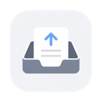
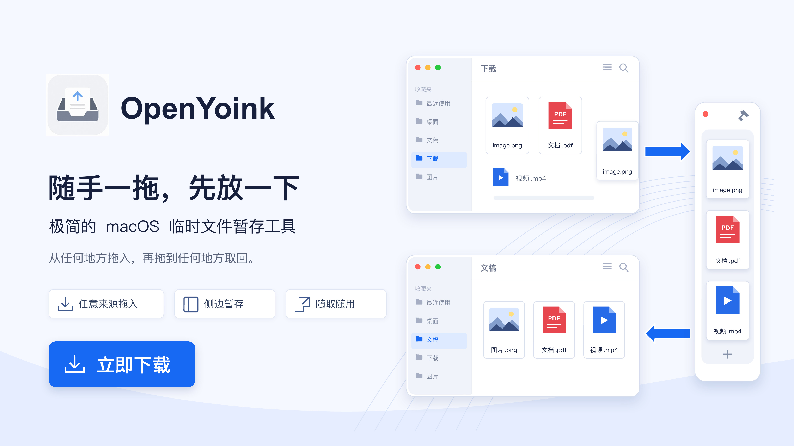
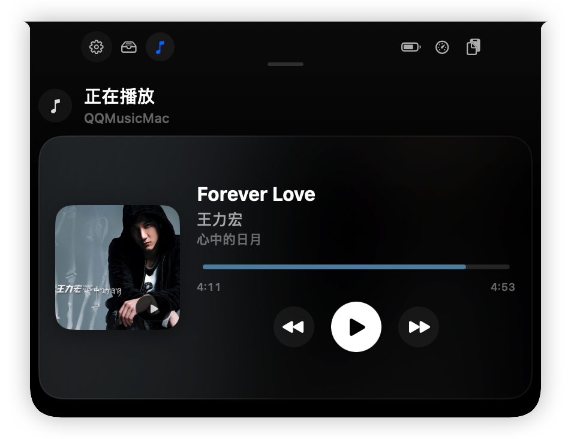
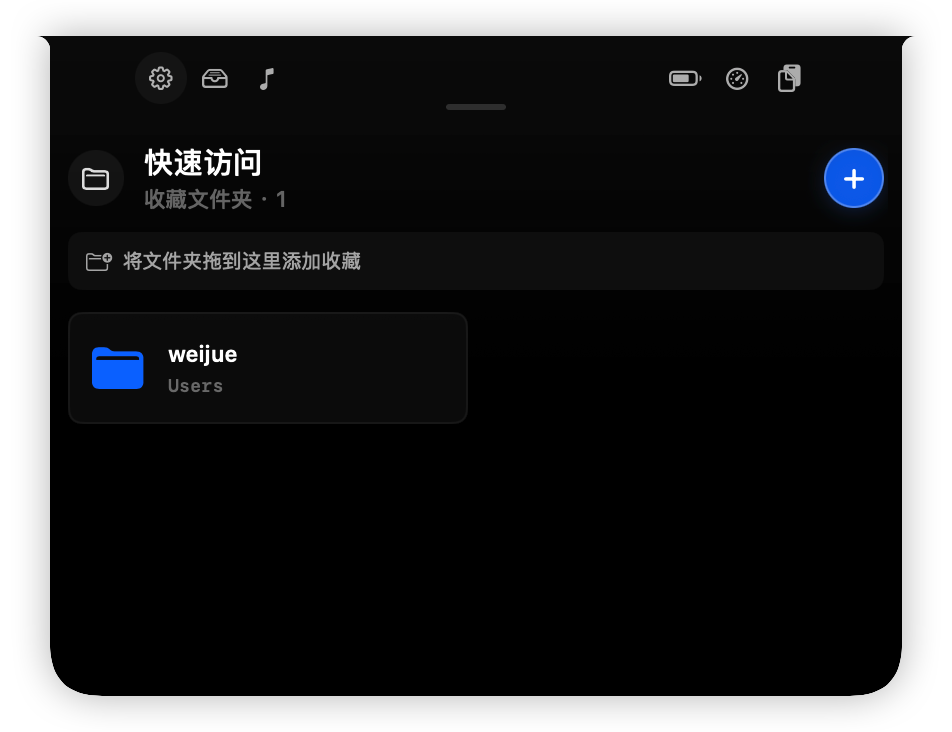
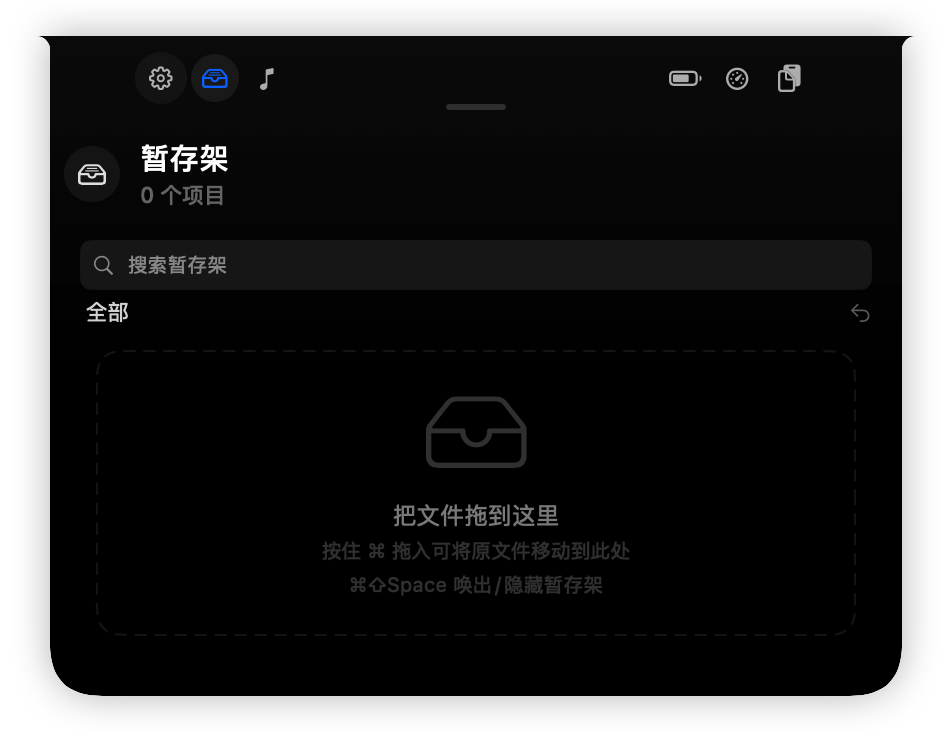
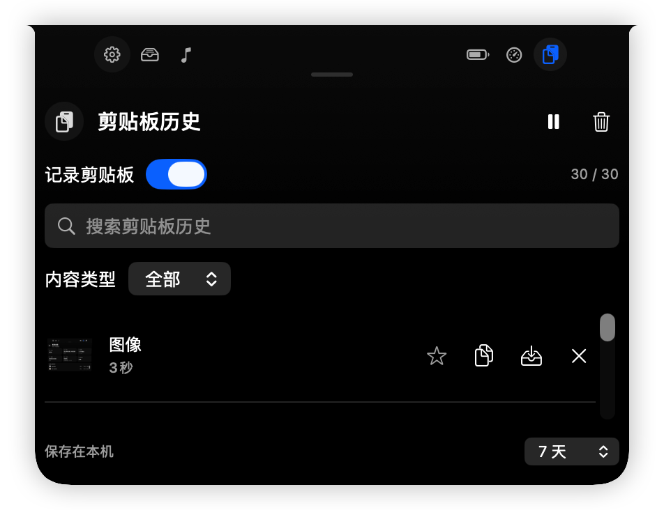
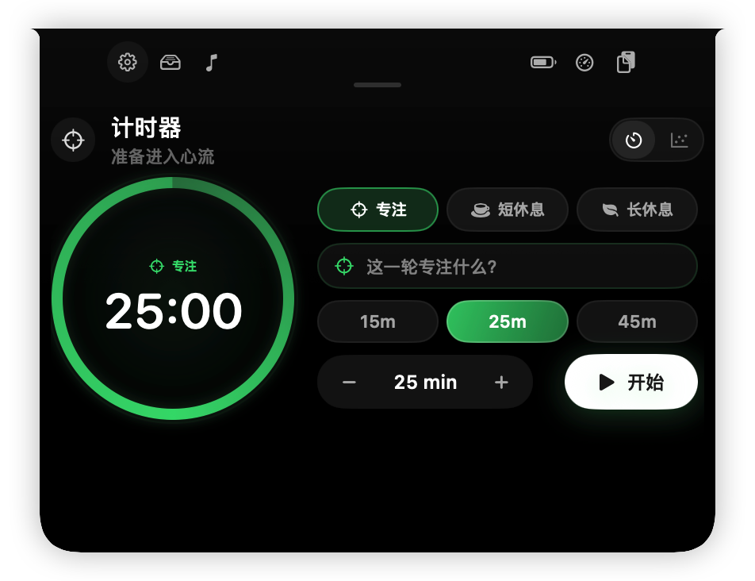
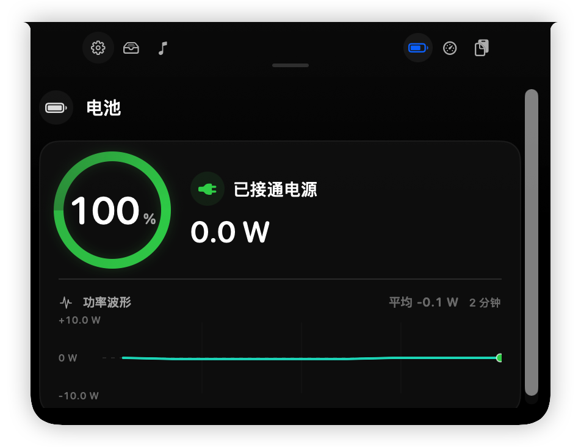
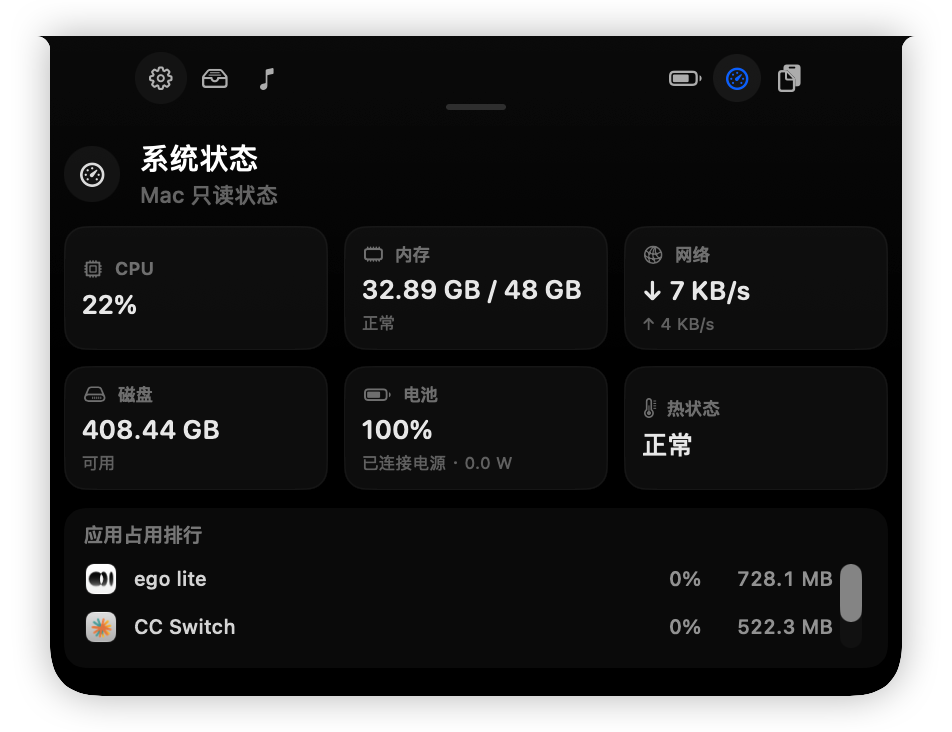
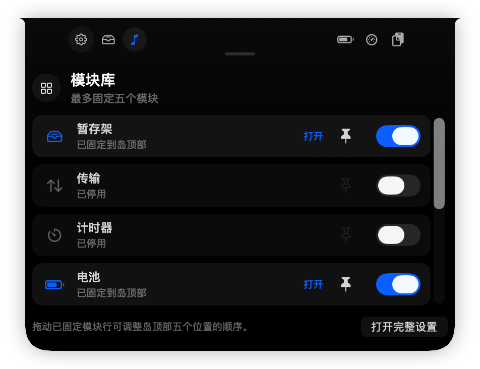

<div align="center">



# OpenYoink

**随手一拖，先放一下。**

一个免费、开源的 macOS 暂存架，顺带一座灵动岛。
文件先放边上，音乐、计时、剪贴板都在屏幕顶部。

<br>

[](https://github.com/MuQY1818/OpenYoink/releases/latest)
[](https://github.com/MuQY1818/OpenYoink/releases)
[](https://developer.apple.com/macos/)
[](https://github.com/MuQY1818/OpenYoink/stargazers)
[](LICENSE)

[下载](https://github.com/MuQY1818/OpenYoink/releases/latest) ·
[官网](https://muqy1818.github.io/OpenYoink/) ·
[灵动岛](#灵动岛模块) ·
[演示短片](https://muqy1818.github.io/OpenYoink/#film) ·
[使用文档](https://muqy1818.github.io/OpenYoink/guide/) ·
[English](README.en.md)

</div>

<br>

<a href="https://muqy1818.github.io/OpenYoink/">
  
</a>

想把下载文件夹里的文件发进聊天窗口？先拖到屏幕边上的 OpenYoink，松手，切到聊天窗口，再从 OpenYoink 拖出去。不用来回摆两个窗口。

它只待在菜单栏，不占 Dock。侧边暂存架和顶部灵动岛可以只开一个，也可以都开，里面的东西是同一份。

## 能做什么

- **什么都能放**：文件、文件夹、文本、图片、链接。来源应用愿意给的话，邮件、日历事件和联系人也行。
- **找得到、理得清**：空格预览，多选、框选、叠成一摞（Stack），搜索、按类型筛选，手滑删了按 `⌘Z` 找回来。
- **随叫随到**：点屏幕边缘的把手、按快捷键、摇一摇鼠标，或者拖着文件靠过去都能唤出。不想在某个应用里被打扰，可以单独关掉。
- **剪贴板历史**：可收藏、搜索、预览，一键丢进暂存架。默认不记录，要你自己打开。
- 多显示器、多个桌面和全屏应用下都能用；中英文界面，可登录时启动，会自动更新。

## 灵动岛模块

OpenYoink Island 待在屏幕顶部。平时收成一条，显示正在播放的歌、倒计时或者传输进度；点一下展开对应的模块。有刘海的 Mac 上它和刘海连成一体，外接屏和没刘海的机器上是一枚悬浮胶囊。

下面都是实际截图，点开看大图。

<table>
  <tr>
    <td width="50%" valign="top">
      <a href="docs/screenshots/island/now-playing.png"></a>
      <p><strong>正在播放</strong><br>不切回播放器也能看封面、暂停、切歌。图里是 QQ 音乐；能不能拖进度条、显示哪些信息，要看播放器或网页自己开放了多少。</p>
    </td>
    <td width="50%" valign="top">
      <a href="docs/screenshots/island/quick-access.png"></a>
      <p><strong>快速访问</strong><br>收藏常去的文件夹，双击用你默认的文件管理器打开（Finder、QSpace 都行）。把文件拖到收藏上就是复制过去，重名会先问你。</p>
    </td>
  </tr>
  <tr>
    <td width="50%" valign="top">
      <a href="docs/screenshots/island/shelf.png"></a>
      <p><strong>暂存架</strong><br>和侧边暂存架是同一份内容，拖进拖出、搜索、筛选、Quick Look 都一样。</p>
    </td>
    <td width="50%" valign="top">
      <a href="docs/screenshots/island/clipboard-history.png"></a>
      <p><strong>剪贴板历史</strong><br>翻找复制过的文本、链接和图片，常用的收藏起来。记录开关是单独的，默认关着。</p>
    </td>
  </tr>
  <tr>
    <td width="50%" valign="top">
      <a href="docs/screenshots/island/timer.png"></a>
      <p><strong>专注计时</strong><br>专注、短休息、长休息三档，可以写一句这轮要干什么。时长自己定，会记下每次专注。</p>
    </td>
    <td width="50%" valign="top">
      <a href="docs/screenshots/island/battery.png"></a>
      <p><strong>电池与功率</strong><br>电量、是否在充电、此刻多少瓦，外加最近两分钟的功率曲线和平均值。</p>
    </td>
  </tr>
  <tr>
    <td width="50%" valign="top">
      <a href="docs/screenshots/island/system-status.png"></a>
      <p><strong>系统状态</strong><br>CPU、内存、网速、磁盘剩余、发热状态，以及哪些应用最占资源。只看不动，不会帮你杀进程或清文件。</p>
    </td>
    <td width="50%" valign="top">
      <a href="docs/screenshots/island/module-library.png"></a>
      <p><strong>模块库</strong><br>用到哪个开哪个，最多钉五个在顶部，拖动排序。没钉的也能从库里打开。</p>
    </td>
  </tr>
</table>

> [!TIP]
> 电池模块显示的是电池这一侧的功率，不是插座的耗电。正数是在充，负数是在放；插着电且已充满时接近 `0 W`，这是正常的。

另外还有一个传输模块，用来看后台交付文件的进度和失败情况。

**AI 用量**（1.8.8 新增，默认关着）：今天在 Claude Code、Codex、Cursor 等工具上花了多少钱、用了多少 token，近 7 天、30 天和累计用量，以及各家额度窗口用到了多少、什么时候重置。快到 80% 和 95% 会在灵动岛提醒一下，收起时也可以选择显示今日花费。数据来自免费开源的 [TokenTracker](https://github.com/xiufengsun/TokenTracker)，用这个模块需要先装好它并让它在后台跑着。

### 怎么配置

新装的 OpenYoink 默认开着灵动岛（**设置 → 通用** 里可以关）。展开后点左上角的齿轮进模块库，打开想用的模块、点图钉钉到顶部，拖一拖调整顺序。收起按 `Esc`，或者点外面、点顶部中间。

懒得一个个挑的话，**设置 → 通用** 里有"文件暂存""文件与剪贴板""完整工具箱"三套预设，只换模块和展开方式，不会动你的文件和历史，也不会替你打开剪贴板记录。

正在播放、快速访问、剪贴板历史这三个模块默认关着。把鼠标拖着文件靠近屏幕顶部来展开灵动岛，这个也默认关着，在 **设置 → 触发器** 里打开，和侧边暂存架的触发方式互不影响。

[灵动岛使用说明](https://muqy1818.github.io/OpenYoink/guide/island) · [各模块详解](https://muqy1818.github.io/OpenYoink/guide/island-modules) · [看 40 秒短片](https://muqy1818.github.io/OpenYoink/#film)

## 安装

需要 macOS 15 Sequoia 或更新的系统，Apple 芯片和 Intel 都能用。

### Homebrew（推荐）

```bash
brew install --cask muqy1818/tap/openyoink
```

安装包同样来自 GitHub Releases。装完后 Homebrew 会去掉 OpenYoink 的隔离标记，所以第一次打开不会被 Gatekeeper 拦下来（但这不代表它经过了 Apple 公证）。

### 手动安装

1. 从 [GitHub Releases](https://github.com/MuQY1818/OpenYoink/releases/latest) 下载最新的 DMG。
2. 打开 DMG，把 OpenYoink 拖进 `Applications`。
3. 第一次打开如果被系统拦住，在 Finder 里右键 OpenYoink 选"打开"，或者去 **系统设置 → 隐私与安全性** 里放行。

> [!NOTE]
> 我目前没有 Apple 开发者证书，Releases 里的版本是 ad hoc 签名，没做公证，所以手动安装时 macOS 会拦一下。之后的自动更新会用 Sparkle 的 EdDSA 签名校验安装包，但第一次下载请自己确认来源。

<details>
<summary>还是打不开？</summary>

先确认安装包是从上面的 GitHub Releases 下的，再核对一下校验值：

```bash
shasum -a 256 OpenYoink-VERSION.dmg   # VERSION 换成实际版本号
```

结果应该和 [Homebrew cask](https://github.com/MuQY1818/homebrew-tap/blob/main/Casks/openyoink.rb) 里对应版本的 `sha256` 一致。确认没问题后，用下面这条命令去掉隔离标记（相当于让 Gatekeeper 放过这一个应用）：

```bash
xattr -dr com.apple.quarantine /Applications/OpenYoink.app
```

</details>

## 快速上手

| 想做什么         | 怎么做                                                   |
| ---------------- | -------------------------------------------------------- |
| 显示 / 隐藏      | `⌘⇧Space`、菜单栏，或点屏幕边缘的把手                    |
| 放东西进来       | 拖到暂存架或边缘把手上                                   |
| 移入（不留原件） | 按住 `⌘` 再拖进来，原文件会进废纸篓，[先看这里](#文件安全与生命周期) |
| 暂存当前剪贴板   | 连按两下 `⌘⇧Space`                                       |
| 剪贴板历史       | `⌘⇧V`（可以在设置里改或关掉）                            |
| 搜索 / 撤销移除  | `⌘F` / `⌘Z`（只能撤销你手动移除的卡片）                  |
| 预览             | 选中后按空格，或双击                                     |
| 多选             | 按住 `⌘` 点选，或在空白处拖出选框                        |
| 移除             | 鼠标悬停点 `×`、按 `Delete`，或右键                      |
| 换位置           | 沿屏幕边缘拖动把手，或在设置里选                         |

更多操作见[使用文档](https://muqy1818.github.io/OpenYoink/guide/)。

## 文件安全与生命周期

直接拖进来的文件，OpenYoink 只记住它在哪，不会移动它。移除卡片、或者打开"拖出后移除"，都不会删掉原文件。拖到 Finder 时只是请求复制一份，收不收由目标应用决定。

> [!WARNING]
> 按住 `⌘` 拖进来是"移入"：先把文件复制到应用自己的沙箱里，确认副本完好后，再把原文件挪进废纸篓。中途出错就保留原文件，按普通方式暂存。清空废纸篓之前，原文件都还能找回来。

移入的东西要等成功拖到目的地后，卡片和沙箱里的副本才会删掉，和普通卡片的"拖出后处理"设置无关。拖出被取消或失败时会原样保留，下次再试。

<details>
<summary>各类内容存在哪、什么时候清理</summary>

| 内容                   | OpenYoink 怎么存                                        |
| ---------------------- | ------------------------------------------------------- |
| 文件、文件夹           | 记住原文件的位置和访问授权（sandbox bookmark），不复制  |
| 纯文本、链接           | 直接存在暂存架的数据里                                  |
| 图片、HTML、RTF        | 在应用沙箱里存成文件                                    |
| 联系人、日历事件、邮件 | 来源应用给得出数据时，存成 `.vcf`、`.ics`、`.eml`       |

原文件被挪走、删掉，或者所在的硬盘没接上，卡片会显示为不可用，等能重新找到文件时会自动恢复。

文本和链接跟着卡片走，卡片删了它们也就没了。图片、富文本、邮件这类生成出来的文件，一般在卡片移除后的下次启动时清掉；也可以去 **设置 → 存储** 手动看看、清理。

普通文件拖出去时，会同时提供文件路径和 Chromium 认得的文件名；移入的文件用 file promise，等目的地确认写好了才从架子上撤下来。具体能不能拖成功，最终还是看目标应用或网站。

</details>

## 隐私与权限

- 不用注册账号，不收集统计数据。东西都存在本机沙箱里的 `Application Support/OpenYoink`。
- 开启了 App Sandbox，只能碰你自己拖进来或选中的文件。日常使用不需要辅助功能或输入监控权限。
- 唯一的后台联网是检查和下载更新（访问 GitHub Pages / Releases），可以在设置里关掉。
- 正在播放模块不联网。它优先用本地 helper 读取播放信息，退而用 AppleScript 控制 Apple Music / Spotify，这时系统可能会问你要"自动化"权限。这个模块出问题不会影响暂存架。
- AI 用量模块只访问本机的 TokenTracker（`localhost:7680`），不连外网，也不读它的文件。
- 快速访问只记住你添加的文件夹位置。取消收藏不会删除文件夹，用什么打开交给 macOS 决定。

### 剪贴板历史

默认不记录。没打开时，只有你连按两下快捷键暂存剪贴板的那一刻才会读一次。打开之后，只记新复制的文本、HTTP(S) 链接和 PNG/TIFF 图片，不会回头翻以前的内容，也不记复制的文件。

历史以明文存在本机，不上传、不同步。普通条目可以留 30、100 或 300 条（默认 30），保留 1、7 或 30 天（默认 7 天）；另外最多收藏 30 条，不会过期。所有内容加起来上限 20 MiB。关掉记录不会删已有的历史，点"清空"才会删。

常见密码管理器标记为隐私的内容、以及你设成忽略的应用，都会跳过，但没办法认出所有敏感信息。复制密码或令牌之前，最好先暂停记录。

## 从源码构建

需要 macOS 15+ 和 Xcode 26+。

```bash
git clone https://github.com/MuQY1818/OpenYoink.git
cd OpenYoink

xcodebuild \
  -project Open-Yoink.xcodeproj \
  -scheme OpenYoink \
  -destination 'platform=macOS' \
  build

xcodebuild \
  -project Open-Yoink.xcodeproj \
  -scheme OpenYoink \
  -destination 'platform=macOS' \
  test \
  -only-testing:OpenYoinkTests
```

用 Swift 6、SwiftUI 和 AppKit 写的。本地构建不需要设置 `DEVELOPMENT_TEAM`；上面的测试命令只跑单元测试，不跑 UI 自动化。

发版用 [`Scripts/make-release.sh`](Scripts/make-release.sh)，可以走 Developer ID 签名加公证，也可以显式传 `--adhoc` 出社区版。签名失败时脚本会直接停下，不会悄悄降级。

## 参与进来

用着不顺手、遇到 bug 或者有想法，欢迎开 [Issue](https://github.com/MuQY1818/OpenYoink/issues)。报 bug 时附上 macOS 版本、OpenYoink 版本和复现步骤会很有帮助；截图前留意别带上私人文件或剪贴板内容。

PR 也欢迎。改动比较大的话，先开个 Issue 聊聊；提交前请跑一遍完整的单元测试。

## Star History

<a href="https://www.star-history.com/?repos=MuQY1818%2FOpenYoink&amp;type=date">
  <picture>
    <source media="(prefers-color-scheme: dark)" srcset="https://api.star-history.com/svg?repos=MuQY1818/OpenYoink&amp;type=Date&amp;theme=dark">
    <source media="(prefers-color-scheme: light)" srcset="https://api.star-history.com/svg?repos=MuQY1818/OpenYoink&amp;type=Date">
    
  </picture>
</a>

## 致谢与许可

OpenYoink 以 [MIT License](LICENSE) 开源。它是个独立项目，和商业应用 Yoink 及其开发者没有关系。

自动更新靠 [Sparkle](https://sparkle-project.org/)，Star 趋势图来自 [Star History](https://www.star-history.com/)。用到的第三方组件和许可证见 [`THIRD_PARTY_NOTICES.md`](THIRD_PARTY_NOTICES.md)。

<br>

<div align="center">

© 2026 weijue · MIT License

</div>
